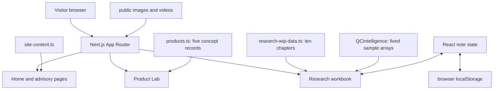

# FMCG Whitespace OS — Project Blueprint

This is a source-grounded guide to the product experience, strategy framework and code. It separates implemented behavior from business hypotheses and example numbers.

**Status:** interactive portfolio study. It has no transaction feed, market research dataset, customer cohort, competitive scraper, live inventory connection or model that discovers validated whitespace. Claims in the content should be independently researched before business use.

## The idea and intended reader

FMCG Whitespace OS demonstrates one way a product manager could reason about better-for-you food and drink: start with the moment a customer is trying to solve, define a sensory promise and format, consider channels and repeat, then test whether the economics and trust signals can support the offer. The intended reader is a recruiter, founder or product team reviewing strategic thinking and a working interface.

The interface presents:

1. A narrative home page and a five-profile Product Lab.
2. An advisory page describing proposed areas of contribution.
3. A ten-chapter research workbook with editorial content, a flavor exploration view, a simulated quick-commerce console and browser-local notes.

It does **not** implement a commercial product portfolio or prove the proposed opportunities.

## Routes and navigation

| Route | Source | Current behavior |
|---|---|---|
| `/` | [`app/page.tsx`](app/page.tsx) | Thesis, portfolio context and links to the main sections. |
| `/products` | [`app/products/page.tsx`](app/products/page.tsx) | Five concept profiles from the product registry, plus occasion and positioning copy. |
| `/how-i-can-help` | [`app/how-i-can-help/page.tsx`](app/how-i-can-help/page.tsx) | Proposed product, retention, channel and execution work. |
| `/research-wip` | [`app/research-wip/page.tsx`](app/research-wip/page.tsx) and [client](app/research-wip/ResearchWipClient.tsx) | Selectable workbook chapters and local notes. |

[`app/data/navigation.ts`](app/data/navigation.ts) defines the three primary navigation links. The research route appears in the shared [Navbar](app/components/layout/Navbar.tsx) under “More” and in the mobile archive menu. [`next.config.ts`](next.config.ts) permanently redirects several older paths, including `/economics`, `/channels`, `/growth` and `/products/:slug`, to current section pages. There is no current per-product route.

The [root layout](app/layout.tsx) mounts the Navbar and Footer, loads Geist and Cormorant Garamond through `next/font/google`, and supplies metadata. [`app/globals.css`](app/globals.css) defines the cream, ink and pistachio design tokens. [`app/robots.ts`](app/robots.ts) disallows crawlers, and layout metadata requests no indexing.

## Architecture and data flow



All displayed strategy and research content is authored in local TypeScript modules. Most pages are server-rendered route components that pass data into interactive client components. There is no application API route, external analytics query, database or scheduled data refresh in the source.

| Location | Responsibility |
|---|---|
| [`app/data/products.ts`](app/data/products.ts) | Five concept profiles: role, occasion, repeat hypothesis, channels and descriptive ratings. |
| [`app/data/site-content.ts`](app/data/site-content.ts) | Site-level narrative and hero content. |
| [`app/data/research-wip-data.ts`](app/data/research-wip-data.ts) | Workbook chapters, example tables, hypotheses, risks and open questions. |
| [`app/types/index.ts`](app/types/index.ts) | Product, workbook, editorial block and other TypeScript shapes. |
| [`app/components/ui/ProductSurface.tsx`](app/components/ui/ProductSurface.tsx) | Renders each concept's image and strategic fields. |
| [`app/components/research/QCIntelligence.tsx`](app/components/research/QCIntelligence.tsx) | Simulated channel dashboard with fixed SKU, zone, keyword and briefing values. |
| [`app/research-wip/ResearchWipClient.tsx`](app/research-wip/ResearchWipClient.tsx) | Chapter selection and persistence of user notes. |
| [`app/components/research/EditorialChapter.tsx`](app/components/research/EditorialChapter.tsx) | Renders typed editorial blocks and uses GSAP for scroll transitions. |
| `public/` | Static images, videos and design assets. |

Other modules, including [`app/data/occasions.ts`](app/data/occasions.ts), [`app/data/growth.ts`](app/data/growth.ts), [`app/data/summer-concepts.ts`](app/data/summer-concepts.ts), `app/data/research/module-01.ts` through `module-06.ts`, and several matching presentation components, have no import path into the current route pages. They are retained concept material, not additional live screens or algorithms. Some occasion-to-product IDs in the unused occasion registry differ from the active five-product registry.

## What the strategic method is

The workbook's method is qualitative decomposition, not statistical inference. It asks a sequence of useful questions:

| Lens | Example question | Current evidence |
|---|---|---|
| Occasion | Which existing customer moment might this replace? | Authored product and workbook copy. |
| Sensory fit | Would taste and texture be good enough to repeat? | Hypothesis; no tasting panel or repeat data in repo. |
| Format and channel | Is the proposed product easy to buy and use in that moment? | Authored channel-fit labels; no measured conversion. |
| Unit economics | Can the realized price cover product, fulfillment and acquisition costs? | Static illustrative tables; no executable financial model. |
| Trust and risk | What claims, proof and operational capacity would be needed? | Editorial prompts and open questions. |

For example, [Rich Cold Coffee](app/data/products.ts) is assigned a “Daily Ritual Anchor” role, an anytime-craving occasion and quick-commerce/office channel fit. This is a positioning hypothesis. The code does not calculate its repeat probability or strategic weight; those values are stored as literals. The simulated console can then illustrate how stockouts could interrupt that proposed ritual. It is a scenario, not observed performance.

“Whitespace” in the project means a proposed gap between existing customer needs and available offers. The repository does not enumerate competitors, measure category size, score gaps, run interviews, or validate willingness to pay. A real study would need those inputs and a documented selection rule.

## Product Lab and workbook mechanics

### Product profiles

The [Product Lab page](app/products/page.tsx) maps over exactly five records in [`products.ts`](app/data/products.ts): Rich Cold Coffee, Rosy Falooda, Mango Tango, Thandai Chill and Coco Chill. [`ProductSurface`](app/components/ui/ProductSurface.tsx) displays each record's role, best moment, repeat language, channel labels and operator note alongside artwork. Fields such as `riskLevel`, `portfolioClassification`, `cannibalizationRisk` and `strategicWeight` are manually assigned registry values. The page does not calculate or display a ranking from them.

The page's “occasion matters more than category” statement is explicitly framed as a working hypothesis in its own source. Additional product and occasion files appear to be preserved exploration material, not a unified live catalog.

### Research workbook

[`researchWipData`](app/data/research-wip-data.ts) defines ten chapters, numbered 00–09. The [workbook client](app/research-wip/ResearchWipClient.tsx) selects one by ID and renders a specialized view by chapter type:

| Type | Rendered by | Function |
|---|---|---|
| `sticky-notes` | [StickyNotesChapter](app/components/research/StickyNotesChapter.tsx) | Four authored, open observations. |
| `qc-intelligence` | [QCIntelligence](app/components/research/QCIntelligence.tsx) | Tabbed simulated channel console. |
| `flavor-lab` | [FlavorLab](app/components/research/FlavorLab.tsx) | Authored flavor, consumer-signal and hypothesis cards. |
| `editorial` | [EditorialChapter](app/components/research/EditorialChapter.tsx) | Typed paragraphs, comparisons, tables, callouts and notes. |
| Default study view | [WorkbookChapter](app/components/research/WorkbookChapter.tsx) | Study blocks and notes, if a chapter uses that type. |

The active workbook includes manufacturing, consumer, economics, competitive identity, risk and unresolved-question chapters. Content tables are rendered from source data. A styled [PasswordGate](app/components/research/PasswordGate.tsx) exists but is not imported by the workbook route; it delegates validation to a caller and provides no current access control.

### Notes and privacy

For editorial/default study chapters, note edits update a `Record<chapterId, text>` in React state and write JSON to the browser key `research_wip_notes`. On mount, the client reads and parses that key. The simulated dashboard, flavor view and sticky-note view do not receive this editable note prop. Notes stay in the current browser profile; there is no account, sync, server backup or access gate. The source handles invalid JSON by logging an error, but it does not validate the parsed structure.

## Simulated channel intelligence

[`QCIntelligence.tsx`](app/components/research/QCIntelligence.tsx) contains fixed arrays for five SKUs, six Bengaluru zones and keyword examples. Its tabs show status, zone coverage, keyword filters, a campaign matrix, a flywheel narrative and a “growth agent” briefing. Zone selection and keyword type filtering are genuine UI interactions over those fixed arrays.

The campaign matrix has **5 × 6 = 30 rendered cells**. Its state rule is:

```text
if post-restock scenario: green
else if SKU sold out: red
else if SKU partial and zone coverage < 50%: red
else if SKU partial: amber
else if SKU live and zone coverage < 50%: amber
else if SKU live: green
```

The post-restock switch sets all cells green. Its “8/36 active” and “18/36 blocked” labels are separately hard-coded and do not count the 30 rendered cells. The timed briefing is a fixed text string revealed by intervals and timeouts; it makes no model or network request. Some statements in the briefing do not agree with the adjacent hard-coded SKU statuses. Thus the dashboard demonstrates a proposed operating view, not an internally reconciled data product.

The useful decision sequence it illustrates is **availability → share of voice → price**: if a product is absent from the shelf, bidding or discounting cannot resolve that availability constraint. This is a strategic principle to test with real channel data, not a measured result of this code.

## Unit economics: auditing the example

The [Unit Economics chapter](app/data/research-wip-data.ts) stores a static table. It does not recalculate when assumptions change. Its displayed inputs are MRP ₹110, GST ₹5.50, discount ₹16.50, COGS ₹40–48 and shipping ₹13–20. A worked arithmetic example is:

```text
Net selling price = MRP − GST − discount
                  = 110 − 5.50 − 16.50 = ₹88

Gross margin after COGS = 88 − COGS = ₹40–48
Gross margin as share of MRP ≈ 36–44%

Post-shipping contribution from shown lines = gross margin − shipping
                                              = ₹20–35 across independent endpoints
```

The first two results match the displayed table. The table labels the post-fulfillment contribution (“CM2”) **₹15–30**, which is not derivable from those listed lines alone; additional costs or different paired assumptions would need to be specified. Its CM3 range and footnote about four purchases and 22% repeat likewise lack a displayed customer-acquisition cost, cohort observations or calculation. They are assumptions in the study.

The quick-commerce fee table lists commission ₹11–18, ads ₹9–15, warehousing/logistics ₹3–5, listing ₹2–5 and funded discounts ₹5–15. Adding the independent endpoints yields fees of ₹30–58; subtracting from ₹110 yields ₹52–80 before any other charges. The table's net-realization range of ₹40–65 is therefore **not reproducible from its listed fee rows alone**. It also lists ₹110 for a 20 g concept at ₹4.40–4.95 per gram; using MRP gives **₹5.50/g**. A different price basis would need to be defined.

These checks are arithmetic on authored example values. They do not establish real product costs, channel fees, category benchmarks or profitability. Before operational use, define price basis (MRP, net of tax, net of discount), channel fees, cost timing, contribution-margin levels and a source/date for each input.

## Setup and configuration

1. Install Node.js and npm compatible with the committed Next.js version.
2. Clone and enter the repository:

   ```bash
   git clone https://github.com/tharungajula2/fmcg-whitespace-os.git
   cd fmcg-whitespace-os
   ```

3. Install dependencies and start the local server:

   ```bash
   npm install
   npm run dev
   ```

Open the local URL printed by Next.js. [`package.json`](package.json) defines `dev`, `build`, `start` and `lint`; there is no test script. [`tsconfig.json`](tsconfig.json) enables strict TypeScript and the `@/*` alias. No database or API key is required. The optional `NEXT_PUBLIC_SITE_URL` environment variable sets the metadata base URL; otherwise the layout uses `VERCEL_URL` if present or localhost.

| Symptom | Check |
|---|---|
| An old route lands on another page | Check the permanent mappings in `next.config.ts`; individual product URLs redirect to `/products`. |
| Workbook notes disappeared | Check the same browser profile and the `research_wip_notes` local-storage key. Private browsing and clearing site data remove local notes. |
| A metric does not respond to changed input | Most metrics are literals in `research-wip-data.ts` or `QCIntelligence.tsx`; only specified UI filters and scenario rules run. |
| A product image or video is missing | Compare its source path with `public/`; asset names use literal underscores/hyphens. |
| Font assets fail in a restricted environment | `next/font/google` in `app/layout.tsx` needs access during framework compilation; inspect the Next error before changing fonts. |
| `npm run test` fails | No test script is declared. |

## Security, evidence and extension paths

- The workbook is publicly routable in the app. The unused password form is not authentication, and `robots.txt`/noindex are crawler instructions rather than privacy controls.
- Local notes can contain sensitive research if a visitor types it. They are stored as plain browser data on that device. The app has no retention, export or sync policy.
- Market, health, price, competition and regulatory statements in the workbook are authored research notes without a traceable evidence pipeline in the app. Do not present the console's stockouts, losses, rankings or “agent” conclusions as live facts.
- A future validated whitespace study would need dated source records, direct consumer evidence, an explicit candidate universe, a reproducible scoring rule and uncertainty ranges. A real unit-economics tool would calculate all contribution levels from editable, sourced inputs and reconcile totals. A real channel console would need permissioned feeds, timestamps and data-quality checks.

The preserved [SOURCE_OF_TRUTH.md](SOURCE_OF_TRUTH.md) records earlier architecture and research intent. Its historical notice points back to this manual for current behavior. For a short portfolio overview, read the [README](README.md).
